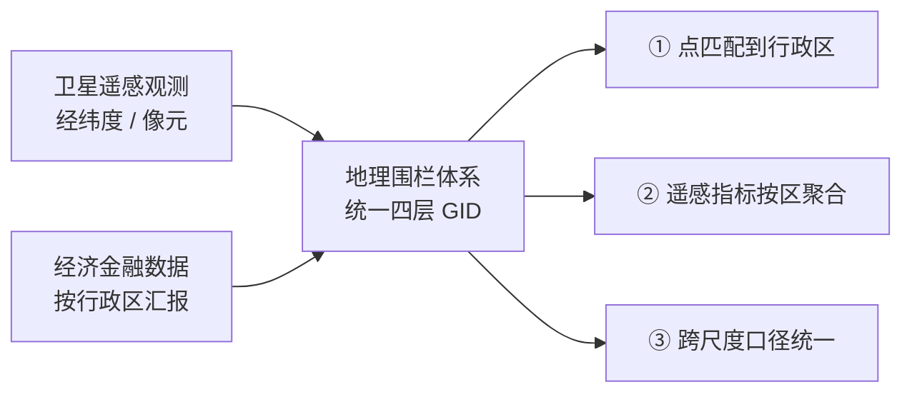

# 地理围栏体系 · Geofence & Geo-Econ System

**深圳数据经济研究院 · 卫星遥感数据研究中心**

**在线地图**：https://cangmingguoke.github.io/geofence-geoecon-system/

把没有行政边界的遥感观测（夜间灯光、土地利用、企业点位等）与按行政区汇报的经济金融数据（GDP、企业注册、人口等）对齐到同一套空间编码，支撑「天-地」数据融合与下游分析。

---

## 覆盖范围

| 内容 | 规模 | 说明 |
|---|---|---|
| 四层行政区划围栏 | 31 国、71,490 个要素 | 近五年名义 GDP 前 20 加 11 个代表国 |
| 经济定义层 | 13 国、186 个都市圈 | OE 全球城市定义，1,811 条成员记录 |
| 城市分区叠加层 | 3,484 条 | 德国 8 城 95 个区，西班牙 1,066 个市镇 3,389 个 distrito |

**已知局限**

1. **中国层已换源至 CTAmap**，县级要素由 2,420 增至 2,858，并补上藏南、南海诸岛与十段线。涉华地图不可作正式出版图，详情见 [`docs/中国围栏换源说明.md`](docs/中国围栏换源说明.md)。
2. **欧洲 163 个 FUA 城市拼不了**：OE 源表只给口径标签、不给成员单元列，德国、英国、法国均受影响，见下文「经济定义层」。
3. **英国与少数国家的 GADM 层有缺名和父级断裂**：英国 L3 有 82 个单元无名字，伦敦、白金汉郡、兰开夏 3 个整块被清洗剔除；荷兰 L2 缺南荷兰省；俄罗斯与阿联酋的 L4 多为 L3 复本。逐条见 [`GADM/README.md`](GADM/README.md) 的「已知几何与属性缺陷」。
4. **地图几何是简化版**：行政边界按 0.002 度、都市圈按 0.005 度简化，不可用于面积量算；精确边界用院内本地的 GeoPackage。
5. **许可**：GADM 及其派生几何禁止商用与再分发；OE 经济定义未经书面许可不得发布。
6. **原始数据与构建脚本在院内本地**：公开仓库只放交互地图与经济定义层产物。

## 数据获取

| 内容 | 位置 |
|---|---|
| 交互地图（`GADM/interactive_map.html`）与各国简化边界（`GADM/map_data/*.js`） | 本仓库，浏览器直接打开 |
| 经济定义层产物（成员表、匹配结果、边界、审核记录） | 本仓库 `经济定义/` |
| 国家清单与各层要素数 | 本仓库 `GADM/countries.csv` |
| GADM 原始与标准边界、构建脚本 | 院内本地，不在公开仓库 |
| 德西四层地理文本与 LAU 边界 | 院内本地 `OECD欧洲数据sample/` |

在 Python 里读边界或做点匹配，见 [`GADM/README.md`](GADM/README.md) 的「使用方法」；复现经济定义层见各样例目录的 README。

## 核心概念

| 术语 | 含义 |
|---|---|
| 围栏 | 行政区划边界的统称，一个行政区对应一块围栏 |
| 经济定义 | 「城市」按经济功能而非行政边界划定，取自 OE《Global Cities》 |
| 都市圈 | 经济定义层里的城市，由若干成员单元拼成，不是行政层级 |
| 成员单元 | 组成都市圈的下一级行政区，如美国的县、日本的市町村 |
| L1 至 L4 | 国家、省州、市郡、区县，对应 GADM 的 ADM0 至 ADM3 |
| 口径 | 概念的定义方式与统计范围，口径不同不能直接比较 |
| 缺口 | 源表列了成员，但底图找不到对应边界，已在图层标注，不硬凑 |
| GID | GADM 的全局唯一行政区编码，如 `USA.47.40_1`，本体系的空间主键 |

## 数据模型

四层围栏靠 GID 串成层级，子表的 `GID_N` 是「父表 GID 加序号」，看编号就知道归属：

| 层 | 表 | 主键 | 外键 |
|---|---|---|---|
| L1 | 国家 | `GID_0` | 无 |
| L2 | 省州 | `GID_1` | `GID_0` |
| L3 | 市郡 | `GID_2` | `GID_1` |
| L4 | 区县 | `GID_3` | `GID_2` |

`HASC_N`（名称缩写）、`CC_N`（本地编号）、`NAME_N`（名称）都不能当主键：美国 L3 有 8 组 HASC 撞码、442 个重名，县层整列没有 CC 码。

经济定义层另有三类表：OE 源表（城市与成员）、`04_FIPS_GADM县代码桥.csv`（美国专用，`fips5` 与 `gid_2` 一比一，561 条零碰撞）、`07_*都市圈成员关系.csv`（最终成员，主键为 `metro_id` 加成员标识）。展示层的 `map_data/{ISO3}.js` 是瘦身副本，`_search.js` 是检索索引，不是表。

## 行政围栏层

**GADM 4.1 四层**：31 国按大洲分组接入，国家层与省州层可靠。各国 L3 语义不同（美国是县、中国是地级市、德国是 Kreis），L3 只是「近似城市层」。

**中国换源**：GADM 中国区县层原有 894 个县级单元无对应几何、408 个名字对不上、32 处错挂父级，现改用 CTAmap（断面 2023-12-31），县级 2,420 增至 2,858。四个 2024 年后新设单元暂缺，港澳台下级仍取自 GADM。十段线另作线层，与阿里 DataV 逐段比对，500 米容差下重合率 100.00%。细节见 [`docs/中国围栏换源说明.md`](docs/中国围栏换源说明.md)。

**德国、西班牙 L4 换源**：GADM 德国 ADM3 是 4,680 个市镇与联合体混杂的单元，西班牙是 369 个 Comarca 且 79% 名字为 n.a.。两国改用 Eurostat GISCO 的 LAU 2024 市镇边界，文本用 OECD TL2024 与 Eurostat LAU 对应表拼成。德国 10,978 个市镇，西班牙 8,132 个，19,111 条按编码连接，1 条海域单元无边界。柏林、汉堡、不来梅在 LAU 里仍是整城一个市镇，市内分区见下一节。

**城市分区叠加层**：德国 8 城 95 个区，取自各市官方 WFS、GeoJSON、SHP、GML；西班牙 1,066 个多区市镇 3,389 个 distrito，取自 INE 2025 年普查区。合计 3,484 条，独立叠加层，不并入四层、不进检索索引。德国另有 7 个主要城市暂无官方分区几何。西班牙 8,132 个市镇里 7,066 个只有 1 个 distrito，区等于市镇本身，不重复产出。

## 经济定义层

OE 的《Global Cities》给 8 张大洲表、899 个城市。本层把源表列出的成员单元对到 GADM 几何，取并集成都市圈。几何定义与经济定义冲突时以经济定义为准。

**13 国 186 个都市圈的结果**

| 国家 | 都市圈 | 成员 | 匹配 | 缺口与口径 |
|---|---:|---:|---:|---|
| 美国 | 88 | 563 | 561 | 巴尔的摩市、圣路易斯市并入同名县，面积没少但分不开 |
| 日本 | 14 | 675 | 672 | 2 个 GADM 版本旧，1 个 GADM 挂错县 |
| 巴西 | 25 | 339 | 338 | `Embu` 同州两个候选，无法唯一判定 |
| 沙特 | 5 | 7 | 6 | `Dammam` 省在 GADM 不存在；4 城按整省 |
| 南非 | 9 | 11 | 11 | 全部按市政全域 |
| 埃及 | 7 | 55 | 55 | 开罗跨 3 省；3 城按整省 |
| 尼日利亚 | 16 | 55 | 54 | `Ibadan Central` 无对应 LGA |
| 马来西亚 | 11 | 16 | 16 | 吉隆坡由 6 个区聚合，其余 10 城是单个区 |
| 泰国 | 1 | 6 | 6 | 曼谷加周边五府 |
| 阿根廷 | 2 | 34 | 27 | 布宜诺斯艾利斯 7 个成员缺失 |
| 秘鲁 | 3 | 38 | 37 | `Pomalca` 缺失 |
| 摩洛哥 | 3 | 8 | 6 | 2 个成员缺失，阿加迪尔圈不成圈 |
| 阿联酋 | 2 | 4 | 4 | 按整个酋长国取，面积大于源表 |

合计 1,811 条成员，1,793 条匹配，18 条缺口，逐条见各样例目录的 `07_质量检查报告.md`。

**缺口的主因在底图一侧。** OEGC 的文本定义了成员，GADM 却没有对应的面：版本偏旧（阿根廷 5 个 1990 年代分设的 partido、摩洛哥 2 个改革后新省）、覆盖不全（`Ibadan Central`、`Pomalca`、沙特 `Dammam`），或者层级根本不同（巴尔的摩市被并进同名县，澳大利亚的 SA4 统计区 GADM 没有这一层）。德国的城市州是另一种情形：柏林、汉堡的 12 个和 7 个 Bezirk 在 OEGC、OECD 与 GADM 的市镇层里都不存在，只能另接市政府数据。处理原则统一为记缺口、不硬套，避免落到分设前的旧单元上。

**欧洲 163 个 FUA 城市拼不了。** 欧洲表 232 个城市里 163 个用 OECD/Eurostat 的 FUA 口径，「本地层级、本地代码、本地名称」三列全空，没有可聚合的对象。能拼的 61 个是一城对一行政单元（俄罗斯 34、土耳其 16、乌克兰 7），与美日的多成员聚合不是同类，接入须标注口径。建议按次序处理：向数据方索取成员构成、暂时只上 61 个非 FUA 城市、换 FUA 官方边界、或留白。

**匹配方法按洲不同**：美国用县 FIPS 码加归一县名；日本用「县加市町村」名称匹配，做罗马字变体与模糊兜底；巴西与沙特没有成员代码，退化到名称匹配，巴西另用 OE 城市坐标落点定州；非洲与拉美表没有代码列，只能按名称匹配。所有未匹配项逐条记录，不静默处理。

**审核与版本**：`07_*都市圈成员关系.csv` 只读，审核动作追加到 `08_审核日志.csv`，状态随时由日志重算，版本号随动作递增。5 类动作：通过、确认缺失、替换、新增、删除。

德国与西班牙另有 OECD FUA 试验样例（98 个和 81 个候选功能区），只完成编码匹配与边界拼合，未接入地图，见 `经济定义/德国样例/` 与 `经济定义/西班牙样例/`。

## 技术要点

**名字不能当键。** GADM 美国 L3 的 3,148 个县里 442 个名字重复，Washington 有 31 个；HASC 由名字推导，同名即同码。匹配一律用 GID 或「州码加归一县名」这类复合键。

**同名消歧。** 检索下拉的副标题带上「国家 · 上级 · 层级」，同名项按上级排在一起；父级取不到时用「精确 GID、去版本后缀、子行自带祖先名」三级兜底，覆盖率 99.98%。中文译名按层级约束，避免 31 个 Washington 县被显示成「华盛顿州」。

**投影与简化。** 边界统一 WGS84。面积用等积投影：美国 EPSG:5070，其余国家 EPSG:6933。展示层几何是简化版，不可量算。

## 数据来源与许可

| 来源 | 用途 | 许可 |
|---|---|---|
| GADM 4.1，https://gadm.org/ | 四层行政围栏 | 学术与非商业使用，禁止再分发 |
| CTAmap 1.30，http://www.shengshixian.com/ | 中国四层 | 免费，须规范引用 |
| Eurostat GISCO LAU 2024 | 德西 L4 边界 | © EuroGeographics |
| Eurostat LAU 2024 对应表、OECD TL2024c | 德西层级文本 | 官方公开数据 |
| INE Seccionado 2025 | 西班牙城市分区 | 官方公开数据 |
| OE《Global Cities》Oct19 | 经济定义 | 版权归 Oxford Economics，须书面许可 |

引用本体系：*地理围栏体系（Geofence & Geo-Econ System）*，深圳数据经济研究院 · 卫星遥感数据研究中心（张博辉教授 / 黄丰博士后团队），2026。

## 术语与缩写

| 缩写 | 含义 |
|---|---|
| GID | GADM 全局唯一行政区编码，本体系空间主键 |
| ADM0 至 ADM3 | GADM 的行政层级，对应 L1 至 L4 |
| MSA / CMA | 美国都市统计区 / 加拿大普查都市区 |
| FUA | 功能城市区，OECD 与 Eurostat 定义的欧洲城市口径 |
| LAU | 欧盟地方行政单元，即市镇层 |
| NUTS | 欧盟地域统计单元分级 |
| FIPS | 美国县代码，5 位，前 2 位州、后 3 位县 |
| HASC | 层级行政区划代码，同名同码，不能当主键 |
| JIS | 日本 5 位市町村代码 |
| SA4 | 澳大利亚统计地理单元，GADM 没有这一层 |
| RM | 巴西都市圈建制 |
| GeoJSON / GeoPackage | 文本矢量格式 / 单文件多图层数据库 |
| POI | 兴趣点，如企业注册地、设施位置 |

## 团队

深圳数据经济研究院 · 卫星遥感数据研究中心（张博辉教授 / 黄丰博士后团队）。数据申请与协作请联系课题组。

更多技术说明：[经济定义层拼合](docs/经济定义层拼合技术说明.md) · [中国围栏换源](docs/中国围栏换源说明.md) · [GADM 层细节](GADM/README.md)
